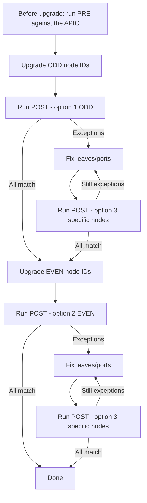

# Cisco DC Operations

An authenticated NiceGUI workspace for ACI pre/post diagnostics, Nexus Dashboard
image staging, NX-OS bootflash preparation, and separate interface-description
operations through Nexus Dashboard. The original three interface-only
CLI modules remain available unchanged in operation; their workflow is documented
under **Legacy Interface-only CLI** below.

## WebUI Setup

Python 3.10+ is required. NX-OS bootflash staging needs Linux and OpenSSH clients.

```bash
cd ~/scotttyso/Cisco-DC-Operations
python3 -m venv .venv
source .venv/bin/activate
python -m pip install -r requirements.txt
python automation_ui.py --create-user operator
python automation_ui.py
```

Enter the WebUI password directly at the terminal prompts (12+ characters).
Open `http://127.0.0.1:8088/`, using VS Code port forwarding for a remote host.
The WebUI account is separate from your APIC/leaf/ND automation account.
Use HTTPS for access beyond local development; see
[automation-appliance/README.md](automation-appliance/README.md).

For customer deployment on a physical Ubuntu 26.04 server, follow
[docs/deploy_ubuntu_baremetal.md](docs/deploy_ubuntu_baremetal.md). Bare-metal uses
HTTPS on port 443 by default, or 8443 when sharing an existing Nginx listener. The
standalone VM uses HTTPS on port 443. HTTP on localhost:8088 is an internal proxy
hop only. The HTTP development URL above is not the customer deployment.

See [docs/releasing.md](docs/releasing.md) for versioned releases and the
administrator WebUI update-check/CLI-install workflow.

For existing bare-metal installations, follow
[Updating and Rolling Back](docs/deploy_ubuntu_baremetal.md#updating-and-rolling-back)
for the `cisco-dc-update` administrator script, bootstrap on older releases,
source-bundle downloads, backups, installation, and validation.

### Navigation

Top-level tabs are alphabetical: **APICs**, **Nexus Dashboards**, **Operations**,
and **Upgrades**. Under **Upgrades**, the **Upgrade workflow** dropdown selects
**ACI Checks**, **NX-OS / Bootflash**, or **NX-OS / ND Staging**. ACI checks remains
the default workflow. Forms keep their state while switching workflows.
The separate **Operations** dropdown continues to select day-to-day tools.

### Theme and Accounts

The sun/moon control switches light/dark themes. Signed-in theme preferences are
saved per account and restored after sign-in or restart.

The **Account settings** button in the header provides **Change password** for
every user. A change requires the current password, a different new password of
at least 12 characters, and confirmation. Saved device credentials are preserved.
Other browser/device sessions must sign in again on their next protected action.

Administrators also have **User accounts**, where they can create operator or
administrator accounts. Operators can run automation and manage APIC inventory,
but cannot create users. Duplicate usernames are rejected, not overwritten.
Create the initial administrator with the local `--create-user` command shown
above. That command can also reset an existing account's password without
changing its role. It invalidates existing sessions for that account.

Existing databases migrate automatically: the first-created existing account
becomes an administrator and other existing accounts become operators. All
sessions created before this upgrade must sign in again. No device credentials
or snapshots are removed by this migration.

### APIC Inventory and Credentials

1. Sign in and open **APICs**. Set the shared **DNS Domain**, then add each APIC's display name, IP/FQDN, and certificate
   verification setting for each fabric. HTTPS certificate verification is on
   by default. Disable it explicitly only for a trusted self-signed lab APIC.
2. Expand **Shared APIC credentials**, enter the Login domain and username/password once, and save.
  This is your default account for all APICs. Each WebUI user has separate,
  encrypted defaults; passwords are never shared between WebUI accounts.
3. **Login domain** defaults to `local`. To use a different domain or
  account on one APIC, enable **Override shared credentials** and save that
  server's account. Disable the override to inherit the shared account again.
4. On **Upgrades / ACI Checks**, select the APIC. The workflow reads the shared
  account or its explicit override; no duplicate password input is required.
  Saved passwords remain blank in editors; blank password fields preserve an
  existing account on an unchanged target. Changed usernames require passwords.

Existing per-server accounts remain server overrides. Setting a new shared
default does not silently replace those accounts; disable the relevant override
to inherit the default. Changing a profile address or TLS setting
invalidates its server-specific saved credentials, not the user's shared default.
Remote ACI domains use the `apic:<domain>\\<username>` login format; local usernames
remain unqualified. Login domain is part of the shared credentials or that user's
explicit server override, not a separate global profile setting.

The APIC inventory is shared by all authenticated operators. Each account's
saved credentials, snapshots, and job directories are separate. All WebUI
accounts are trusted automation operators, not read-only viewers.

The **DNS Domain** is one shared setting for all APICs/fabrics and all WebUI users,
not a per-APIC field or hard-coded Python value. It is used only
when a switch has no OOB address and its name is not already fully qualified.
Leave it blank to use the server's DNS search domains. A single unique domain in
older per-APIC settings migrates automatically. Conflicting old values produce a
warning on **APICs** instead of choosing one; save the correct shared DNS Domain.
IP addresses and fully qualified names are never modified.

### ACI SSH Through Nexus Dashboard

ACI capture offers **Direct SSH** or **SSH via Nexus Dashboard**. The latter uses:

```text
automation server --HTTPS--> APIC (discovery)
automation server --SSH/rescue-user--> Nexus Dashboard --SSH/APIC account--> leaf or spine
```

Only CLI SSH uses the jump. APIC discovery and all ND API requests remain direct
HTTPS from the automation server. Select a saved **SSH jump dashboard** and save
its rescue-user password on **Nexus Dashboards** before running captures.
ND must already allow rescue-user SSH and outbound SSH to the switches. No SSH
service, fabric configuration, or appliance permissions are enabled by this tool.

The jump path requires Linux/OpenSSH and uses the existing bootflash SSH prompt
and authentication helpers, including host-key acceptance and legacy-crypto
fallback behavior. Review these policies for production. It opens one ND SSH
session per captured switch and serializes unproven logins until one succeeds;
an initial authentication rejection stops further attempts in that run.
Passwords are not put in SSH command arguments, global environment variables,
snapshots, or session logs. Commands remain guarded `show` commands; only temporary
CLI paging/width settings are sent for capture. Both hops are closed afterward.
The jump path has mock coverage but has not been certified against live ND/ACI.

### ACI Diagnostics

The expanded workflow discovers active **leaf and spine** switches and captures
commands through one SSH connection per switch. These defaults run on both roles:

```text
show interface brief
show environment
show module
show lldp neighbor
show isis adjacency vrf all
```

These defaults run on leaf switches only:

```text
show vpc
show port-channel summary
show endpoint summary
show mac address-table dynamic | egrep -v tun
```

**Commands by role** contains separate leaf/spine lists, one command per line.
Additional guarded `show` commands can be entered and saved per APIC using
**Save role commands**. Non-show commands, redirection, chaining, and arbitrary
pipelines are rejected. The known leaf-only command families cannot be assigned
to spines. Custom show commands may be expensive or expose sensitive data; test
on one switch and review command support before running them fabric-wide.

Each new PRE snapshot records its role-command lists. POST reuses those recorded
lists even if the saved configuration has since changed. Existing snapshots
without role metadata are treated as leaf-only; capture a new PRE including
spines before comparing spine results. The legacy interface-only CLI remains
leaf-only and does not use WebUI profiles or role-command settings.

`show isis adjacency vrf all` is one command, not a newline-separated sequence.
Only the exact MAC-table filter above is allowed; arbitrary pipelines and
chaining remain blocked. Unsupported commands are retained as errors for review;
ACI release/platform syntax has not been verified against live hardware here.

1. Select **PRE baseline**, **Leaf and spine**, and **All node IDs**, then run the checks before upgrading.
  Discovery queries active switches through APIC. SSH uses OOB IPs, falling
  back to the switch name and the shared DNS Domain saved on the APICs tab.
2. Resolve all capture errors before the upgrade. Each PRE run creates a new
   immutable JSON snapshot; previous baselines are not overwritten.
3. Select **POST comparison**, the appropriate PRE snapshot, and odd/even/all or
  specific node IDs, plus the desired role. POST uses the baseline switch list without rediscovering APIC.
4. Review results, inspect individual command output/differences, and download
  the full JSON report. Capture history survives restart and includes provenance.
  ACI capture history is shared with every WebUI user, including older captures
  from per-user storage; treat its raw device output as visible to all operators.
  Administrators can delete shared ACI captures older than a chosen number of
  days. PRE baselines referenced by newer retained POST captures are preserved;
  other job and operation reports remain per-user.

PRE captures appear in the **Pre** output tab and open there by default; the
**Post** tab is populated only by a POST capture. This also applies when viewing
older saved PRE snapshots, without rerunning any device commands.

Interface results compare normalized physical-port up/down status, including
missing ports. `show environment` compares supply/module/fan identity, model, and
status; output watts, draw, capacity, and total-power values are ignored.
`show isis adjacency vrf all` compares neighbor system ID, interface, and state;
hold time, SNPA, and level are ignored. Other commands use whitespace-trimmed,
order-sensitive text diffs. **REVIEW** means output changed, not necessarily that
the device is unhealthy. **ERROR** and **NO_BASELINE** never count as a match.
There is no automatic health verdict for the extra commands. The viewer limits
individual command text to 60,000 characters; downloaded reports retain full data.

### Large-Fabric Investigation View

Each snapshot has a **switch-level** summary, such as **Investigate 3 of 300 switches**,
with separate leaf/spine counts. Several changed/failed commands on one switch
count as one affected switch. **Switches to investigate** lists node IDs, names, roles, changed-check
counts, capture errors, missing baselines, and contextual reasons. Select a leaf
and choose **View switch findings** to narrow its command findings.

POST reports default to **Result = Needs investigation**, showing only `REVIEW`,
`ERROR`, and `NO_BASELINE` findings. Choose **REVIEW - changed output** for an
exact result filter, rather than a text search. Result, Role, Switch, Command, and search
filters combine; the result explanation changes with the selected state.
The leaf summary always covers the whole selected snapshot, regardless of filters.

- **REVIEW:** PRE and POST differ. Interface changes are shown with port and
  direction; other text changes may reflect expected counters or operational churn.
- **ERROR:** Capture/parsing failed; the affected check is not verified.
- **NO_BASELINE:** No usable PRE data exists; POST alone cannot establish a match.
- **MATCH:** Interface states or command text match PRE, not a full health verdict.
- **CAPTURED:** A PRE baseline was recorded; no POST comparison has happened.

The overview tables carry compact findings rather than full raw outputs. Use
**Inspect result** for PRE/POST/difference text. Downloads include all results and
the complete leaf summary, not just the filtered rows. Capture logs are collapsed
by default. The tests cover a synthetic fabric of 300 leaves (2,700 checks).

PRE validates credentials with APIC. POST serializes SSH until the first successful
capture; an initial authentication rejection stops further unproven logins in that
job. The new bundle has bounded connect/read timeouts and does not retry failures
automatically; rerun the affected nodes after investigation. Legacy CLI retries
are unchanged. Authentication protection is per job, not a cross-job lockout guard.

### NX-OS Upgrade Workflows

- **NX-OS / ND staging** invokes `nd_stage_nexus_updates.py`. Select a saved dashboard
  and choose **Named update groups** or **Per-switch groups**. Named groups have
  an **Update group name** and a **Member switches** list; use **Add update group**
  for multiple groups, or the remove icon to discard one. Members accept names,
  IPs, or serials separated by commas, spaces, or newlines. Per-switch mode retains
  the original single switch-list workflow. Its login/domain/TLS settings come
  from Nexus Dashboards. The default is plan-only. Applying
  creates/reuses update groups, attaches checks, and requests staging; it does not
  start the NX-OS install.

The **Upgrade rules YAML** editor is prefilled with the current default rules and
retains edits in your browser session. Its `upgrade_rules` list replaces all
defaults for both plan and apply; the first matching rule wins. Model patterns
are case-insensitive shell-style patterns; only N9K devices are eligible. Quote
source/target versions. A source of `"10.6"` matches `10.6(3)` and `10.6.3`, not `10.60`.
For example, append this entry to the editor's list for that model:

```yaml
  - models: ["N9K-C93240YC-FX2"]
    source_version: "10.6"
    target_version: "10.6.4"
```

Verify your supported upgrade path and target before running. The target image
must be uploaded to ND. Invalid YAML or malformed/empty rules block the job
before launching a process. Standalone CLI configs can also include
`upgrade_rules`; omitting the section preserves the original defaults.

Named mode generates `update_groups` rather than `switches.hosts`; inactive-mode
fields are ignored. Names must be unique and contain 1-48 letters, digits,
underscores, or hyphens. Empty groups and repeated switch selectors across groups
are rejected before launching the job. ND inventory resolution also rejects the
same physical switch selected through different aliases in multiple groups.
Each group must share a fabric, target image, and check set; vPC and standalone
switches should be placed in separate compatible groups. Existing-group membership
and custom-check safeguards remain enforced by the bundled script.

See [examples/nexus_dashboard/nxos_update_groups.example.yaml](examples/nexus_dashboard/nxos_update_groups.example.yaml)
for the generated input structure. In the UI, use saved dashboard credentials;
the example's login settings are only for standalone CLI use. The default remains
plan-only; applying named groups requires confirmation and stages images without
starting an NX-OS installation.
- **NX-OS / Bootflash** invokes `nxos_bootflash_stage.py` with the YAML input sheet.
  The example addresses/catalog are placeholders: replace them with your approved
  switches and upgrade paths. The automation username overrides switches.username.
  Supply switch and SCP passwords separately. When not connecting directly, select
  a saved ND SSH jump dashboard; its rescue password comes from the shared ND
  account or dashboard override, not this form. The default is dry-run. Applying can **delete old images** and
  copy new ones, using the source script's existing rules. No upgrade is started.

Both upgrade workflows require confirmation before applying changes. Use the cancel action to
terminate a running NX-OS job; cancellation does not undo completed device changes.
Saved ND credentials use shared defaults with server overrides; bootflash switch
and SCP credentials remain one separate bundle per WebUI account. Console logs
can be downloaded after a job finishes.

Both staging implementations are bundled in this repository's `nxos-scripts/`
directory. No sibling checkout is required. `DC_NXOS_SCRIPTS_DIR` can optionally
override that directory. The ND integration uses the `nxos_` custom-check
namespace and requires an explicitly supplied ND address. It creates
`nxos_mac_address` with `show mac address dynamic | sort`; an existing
`mac_address` definition is not required. Existing default or previous-prefix
checks are not renamed or deleted. All selected custom checks use a 360-second
post-update delay.
YAML may not contain passwords, vault paths, or custom SSH options. The existing
bootflash script's host-key acceptance and legacy crypto fallback remain in effect;
review those policies before using it in production.

### Nexus Dashboards and Operations

The **Operation** menu under **Operations** selects the tool to run. Its first
entry is **Nexus Dashboard - Interface Descriptions**, independent of ACI PRE/POST captures.
It does not create a baseline, run upgrade checks, or start an upgrade.

Additional tools are registered in the UI's `OPERATION_CATALOG`, each with its own
menu label and panel builder; operation-specific forms stay under their selected tool.

1. On **Nexus Dashboards**, add the appliance display name, HTTPS address,
  and TLS verification setting. **Shared Nexus Dashboard
  credentials** stores your default **Login domain**, username, password, and **Rescue-user password**
  for all ND appliances. Add/Edit can enable **Override shared credentials** on a
  single appliance. API and rescue passwords are different fields; the login
  domain applies to the API account, while SSH uses the fixed `rescue-user` name.
  Profiles are shared by operators, but credential defaults/overrides are private
  to each signed-in WebUI account.
2. Open **Operations**, choose **Nexus Dashboard - Interface Descriptions** from
  **Operation**, select **Nexus Dashboard appliance**, and choose **Connect dashboard**.
  The saved default or override account is used; no duplicate password form is
  needed. ND session tokens stay server-side. Changing a dashboard target/TLS setting removes saved
  profile credentials and requires reconnection.
3. Select **Fabric** and **Switch** from discovered lists, then **Load interfaces**.
  Physical Ethernet ports, including breakout ports, are listed with their current
  description, policy, and mode. Filter the table and select the required ports.
  Repeated collection records are grouped into one row per port. Conflicting
  displayed values show an **ND data note** and require a fresh interface preview;
  discovery never chooses one conflicting configuration as the update source.
4. Enter a separate value in each interface row's **New description** field.
  Select the checkbox for each edited port to include it in preview. The per-row
  trash icon explicitly clears a description; the undo icon discards that port's
  pending edit. Emptying a typed field cancels its edit rather than clearing ND.
  Unselected edits remain pending and are not applied.
5. **Preview changes** GETs each selected, edited interface's current settings and shows old
  and new descriptions. Preview never sends PUT. **Apply descriptions** requires
  confirmation naming the dashboard, fabric, switch serial, and change count.
6. Review each result and download the operation report. Test a single noncritical
  interface before using this against a live dashboard.

The filter has **Text** and **Regex** modes. Regex searches interface names, so
`1/1[4-5]` matches ports 14 and 15 and any matching breakout children; use
`1/1[4-5]$` to match only `Ethernet1/14` and `Ethernet1/15`. Invalid patterns show an
error and invalidate any existing preview. Filters and pagination preserve per-port
edits and selections; the edit count reports selected edits hidden by a filter.
Changing a row or its selection requires a new preview before applying.

Ports without an assigned policy, or with an unknown/empty mode, remain visible
but are grayed out. Their selection checkbox, description field, clear action,
and undo action are disabled; **Unavailable reason** explains why. Conflicting
policy/mode values in ND collection records also make a port unavailable.
The table-header bulk-select action selects only available filtered interfaces.

Policy and mode are rechecked on the fresh GETs used for preview and apply.
If either becomes unavailable after loading the list, the update is blocked and
no PUT is sent for that port. An unknown mode is never replaced with a guessed
access/trunk configuration.

The API adapter uses the existing ND login and switch inventory endpoints, then:

```text
GET /api/v1/manage/fabrics/<fabric>/switches/<serial>/interfaces
GET /api/v1/manage/fabrics/<fabric>/switches/<serial>/interfaces/<encoded-interface>
PUT /api/v1/manage/fabrics/<fabric>/switches/<serial>/interfaces/<encoded-interface>
```

Interface path components are encoded, including `Ethernet1%2F15%2F1`. Each PUT
contains the existing `interfaceName`, `interfaceType`, `switchId`, and a deep copy
of `configData`; only `configData.networkOS.policy.description` is changed.
VLANs, vPC membership, port-channel/LACP settings, mode, and admin state are retained.
Unrecognized GET payloads, identity mismatches, and non-Ethernet interfaces are
rejected rather than filled with guessed settings.

Apply re-GETs each interface before writing. Changes since preview produce
**CONFLICT** and skip that port. Unchanged descriptions require no PUT. A post-PUT
GET verifies ND's stored settings, producing **UPDATED** or **VERIFY_REQUIRED**.
**ERROR** indicates a failed operation; other selected ports may still succeed.
GET/PUT is not an atomic transaction, so avoid concurrent edits to the same ports.

The tool sends no separate deploy action and does not verify the switch running
configuration. Whether a PUT deploys automatically depends on your ND version and
workflow; inspect ND's pending changes and follow your approved deployment process.
API behavior has been tested with mocks, not certified against a live ND release.
Descriptions have no guessed platform length limit; ND validates release-specific
limits. Multi-interface updates have no automatic rollback. Do not blindly retry
after an uncertain network failure; reload current settings first.

Operation reports are private files under the signed-in user's `runs/.../operations`
directory and include targets, timestamps, old/new descriptions, and per-port
outcomes, not passwords/tokens. `IN_PROGRESS` after a process failure means the
result is uncertain. Completed reports are finalized by the worker even if the
browser disconnects. ND staging, Operations, and SSH-jump selectors share dashboard
inventory and the signed-in user's shared/override ND credentials. Bootflash's
switch/SCP credentials remain separate from ND API and rescue-user credentials.

### Storage and Security

- Default state: `~/.local/share/cisco-dc-automation` (`DC_AUTOMATION_DATA`).
- Default master key: `~/.config/cisco-dc-automation/vault.key`
  (`DC_AUTOMATION_KEY_FILE`). A new key is created with mode 0600 on first use.
- APIC inventory and password hashes live in a private SQLite database. Automation
  credentials use authenticated Fernet encryption; they are never included in APIC
  inventory, command arguments, or NiceGUI session storage. Password inputs are
  cleared after save/start. WebUI passwords use salted PBKDF2-SHA256 hashes.
- A secret manager can inject a Fernet key as `DC_AUTOMATION_KEY`. The server needs
  the same key after restart. Back up the state and key separately; do not commit
  either. A replacement key cannot decrypt existing saved credentials.
- Encryption protects data at rest, not a compromised application/service account
  or root. NX-OS credentials exist in that job's child-process environment while
  it runs; local administrators can inspect them. The master key environment
  variable is explicitly excluded from child jobs.
- Captured console output is redacted. The unmodified bootflash script writes raw
  received session output into its private job directory; these logs are scrubbed
  at completion. Do not assume arbitrary device output is secret-free, especially
  if a process is killed before cleanup. Reports/logs contain sensitive network
  data. Set an appropriate retention/backup policy; no automatic purge is enabled.
- WebUI sessions expire after eight hours, with login throttling. Use
  `--secure-cookies` behind HTTPS. Do not expose the development HTTP server to an
  untrusted network. User creation is admin-only in the UI; bootstrap/recovery
  resets remain available through the local `--create-user` operation.

### Standalone Appliance

This repository owns its complete Rocky Linux Packer appliance build, guest
provisioning, first-boot setup, HTTPS configuration, OVA/qcow2 export tooling,
and OpenShift deployment examples. It packages an allowlisted set of source files
from this checkout; no other application repository is cloned or needed.
See [automation-appliance/README.md](automation-appliance/README.md) for build and
deployment instructions. VM images and private build variables are not committed.

### Tests

```bash
.venv/bin/python -m unittest discover -s . -p test_upgrade_checks.py -v
```

Tests use synthetic credentials and mocked devices, plus a real local subprocess
for environment/redaction checks. They do not certify live APIC/ACI/ND operation.

---

## Legacy Interface-only CLI

These scripts take a snapshot of every leaf's physical port status (up/down) **before** the
upgrade and compare it **after** each upgrade group (odd / even node IDs). Only the problems are
shown: leaves that are not reachable and ports whose status changed.

> **Read-only.** The scripts query the APIC (GET only) and send a single `show interface brief`
> to each leaf. Nothing is configured, cleared or saved on any device.

---

## 1. What's in the folder

| File | Purpose |
|---|---|
| `aci_leaf_ifstatus_pre.py` | Run **once, before the upgrade**. Discovers all active leaves from the APIC and captures port status. |
| `aci_leaf_ifstatus_post.py` | Run **after each upgrade group**. Compares current port status to the pre capture. |
| `aci_ifstatus_common.py` | Shared code used by both scripts (do not run directly). |
| `<leaf>_ifstatus_pre.csv` | Created by pre: one per leaf, the port-status baseline. |
| `ifstatus_pre_manifest.csv` | Created by pre: leaf list (node ID, name, OOB IP), APIC and capture time. Post uses this. |
| `aci_leaf_ifstatus_pre.log` | Created by pre: run log. |

---

## 2. Prerequisites

- **Python 3.10+** and the `netmiko` library (everything else is built into Python):
  ```powershell
  cd "<path>\_Python_Scripts"
  python -m venv .venv
  .\.venv\Scripts\Activate.ps1
  pip install "netmiko>=4.0"
  ```
- **Network access** from your PC to:
  - the APIC on **HTTPS (443)** – pre script only
  - every leaf's **OOB management IP on SSH (22)** – both scripts
- **Credentials**: your `username` account. The same username/password is used for the APIC and
  for the leaves; you are prompted once per run. The password is never stored.

---

## 3. Upgrade-day workflow



### Step 1 – PRE capture (before any leaf is upgraded)

```powershell
cd "<path>\_Python_Scripts\aci_leaf_ifstatus"
python aci_leaf_ifstatus_pre.py --apic <APIC_IP>
```
You will be prompted for username and password.

What happens:
1. Logs in to the APIC and lists every leaf with **fabric state = active** (node ID, name, OOB IP).
2. SSHes to each leaf (20 in parallel) and runs `show interface brief`.
3. Writes `<leaf>_ifstatus_pre.csv` per leaf and `ifstatus_pre_manifest.csv`.

At the end, check for any **`NO BASELINE`** lines. Those leaves could not be captured and will not
be verified by the post script. Fix access and re-run pre **before** starting the upgrade.

> **Warning:** Do **not** re-run the pre script once the upgrade has started. It overwrites the
> baseline with the current (possibly broken) state.

### Step 2 – Upgrade the ODD node IDs

Proceed with the upgrade per the change plan.

### Step 3 – POST check of the ODD group

```powershell
python aci_leaf_ifstatus_post.py
```
```
Baseline: APIC 10.x.x.x, captured 2026-10-09 14:02:11, 212 leaves
Check which leaves?  1) ODD node IDs   2) EVEN node IDs   3) Specific node ID(s)  : 1
106 odd leaves: node 101 .. 311
Username: <username>
Password for <username>:
```
**Always confirm the `Baseline:` line shows the APIC/fabric you are working on.**

### Step 4 – Fix and re-check only the affected nodes

After fixing the issues, re-check just those nodes instead of the whole group:
```
Check which leaves?  ... : 3
Node ID(s), comma or space separated (e.g. 101 or 101,103): 103 117
```

### Step 5 – Upgrade EVEN, then POST with option 2

Only move on to the even group once the odd group reports
`ALL ODD LEAVES ONLINE AND PORT STATUS MATCHES PRE.`

---

## 4. Reading the POST report

Only exceptions are printed. Example:

```
==============================================================================
 ODD leaves: 106 checked in 95s   103 match   2 with port changes   1 not checked
==============================================================================

Leaves NOT verified (offline / unreachable / no baseline):
  node 105   leaf105            UNREACHABLE   10.x.x.x: NetmikoTimeoutException

node 103  leaf103  -- 3 port change(s), 2 went down
  Port        Pre         Post        Post reason
  ----------  ----------  ----------  --------------------
  eth1/1      up          down        link-not-connected
  eth1/2      down        up          none
  eth1/49     up          (missing)

All ports match pre on node(s): 101, 107, 109, ...

ACTION REQUIRED: review the leaves/ports listed above.
```

| What you see | Meaning / what to do |
|---|---|
| `up → down` (red) | Port was up before, down now. **Investigate**: check the reason column (e.g. `link-not-connected`, `sfp-missing`, `err-disabled`). |
| `down → up` (yellow) | Port came up that was down before. Usually harmless, but confirm it's expected. |
| `(missing)` | Port exists in only one capture (e.g. breakout change, module not detected). Investigate. |
| `UNREACHABLE` | No SSH after all retries. Leaf is probably still rebooting or offline. Wait, then re-run with option 3. |
| `AUTH_FAIL` | Login rejected. Check password; after a reboot AAA may briefly reject logins. `not attempted: password rejected by another leaf` means the run stopped logging in after the first rejection (see **Retries** below). |
| `NO_BASELINE` | The leaf failed during pre (manifest capture status not `OK`) or its pre CSV is missing. It cannot be compared. |
| `CAPTURE_FAIL` | Connected but the command output could not be read/parsed. Re-run with option 3. |

Status is normalised to **up** or **down**. Anything that isn't `up` counts as `down`, so a port
that was admin-down before and is still admin-down is **not** reported.

---

## 5. Options

| Option | Script | Default | Description |
|---|---|---|---|
| `--apic IP` | pre | prompt | APIC IP or hostname. |
| `--group odd\|even` | post | prompt | Skip the menu. |
| `--username NAME` | both | prompt / `$ACI_USERNAME` | Login username. |
| `--workers N` | both | 20 | Leaves processed in parallel. |
| `--retries N` | both | 2 | Extra SSH attempts per leaf after a failure (`0` = off). |
| `--retry-delay S` | both | 15 | Seconds between attempts. |
| `--connect-timeout S` | both | 20 | SSH connect timeout. |
| `--read-timeout S` | both | 90 | Time to wait for command output. |
| `--verify-tls` | pre | off | Verify the APIC certificate (off because our APICs use self-signed certs). |

**Retries:** connection/timeout errors are always retried. In **pre**, login failures are retried
too (the APIC already validated the password). In **post**, leaves are logged in to one at a time
until one accepts the password, then the run goes parallel. If the first login attempt is rejected,
no further leaves are tried and all remaining leaves show `AUTH_FAIL`. Once the password is proven,
login failures on other leaves are retried (AAA can briefly reject logins after a reboot). This
avoids locking your account if the password was mistyped.

---

## 6. Good to know

- **One fabric at a time.** Files are written next to the scripts and every pre run overwrites
  the manifest. If you start on another fabric, the post script compares against the last fabric
  captured. Check the `Baseline:` line.
- **All physical ports** are captured (`eth1/1-54`, `eth1/1-108`, breakouts like `eth1/1/1`).
  Port-channels, SVIs, loopbacks and mgmt0 are ignored.
- **Inactive leaves** (decommissioned, maintenance, inactive) are not discovered by pre and
  are therefore not checked.
- Leaves are reached **directly from your PC** via their OOB IP (from the APIC), not through the
  APIC. Without an OOB address, the legacy CLI resolves the leaf name using the host's DNS search domains.
- The post script writes **no files**. Copy the terminal output into the change record if needed.
